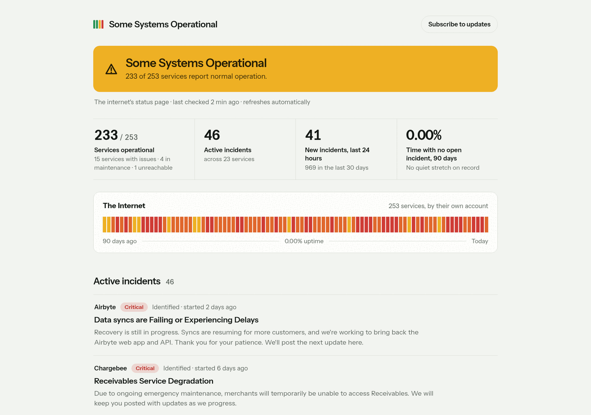
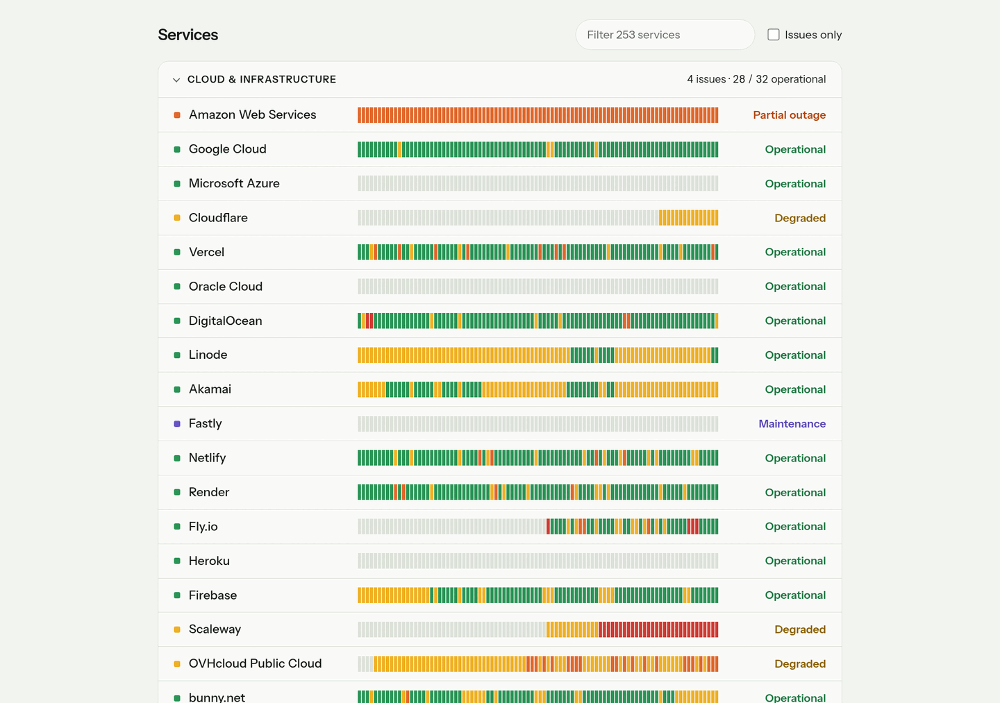
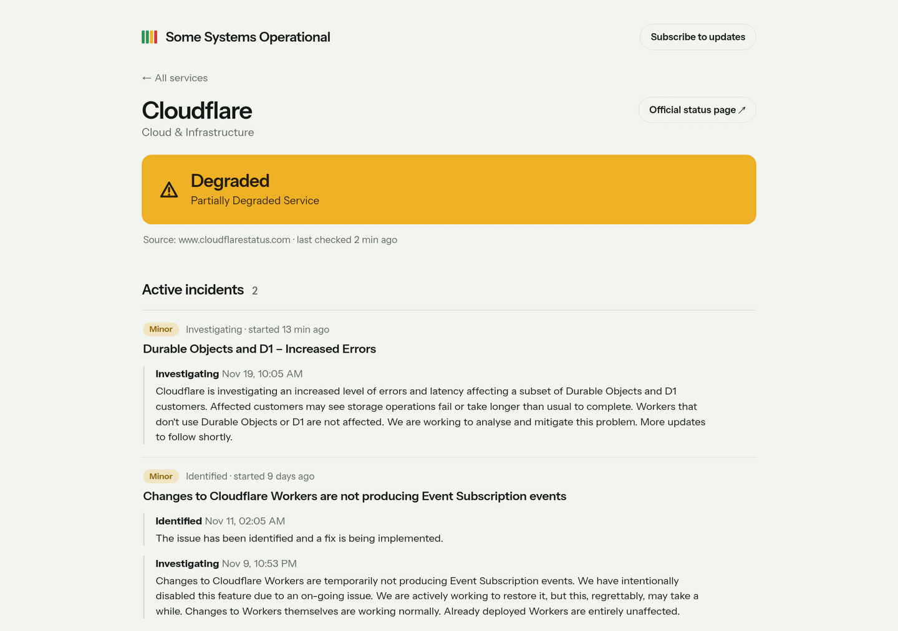

# Some Systems Operational

**[somesystemsoperational.com](https://somesystemsoperational.com)** is one status page for the whole internet.

It reads the public status pages of 250+ services (clouds, AI providers, developer tools,
SaaS, payments, social) every two minutes and puts them on one screen, with a page and
90 days of incident history for each. Every status is what the provider itself reports.
Nothing is probed or guessed.

<picture>
  <source media="(prefers-color-scheme: dark)" srcset="docs/home-dark.png">
  
</picture>

| Every service, with its history | One service |
|---|---|
|  |  |

## Run

```sh
npm start   # http://localhost:3000
npm test
```

Needs Node 22 or newer. No dependencies, no build step, no database. There is a `Dockerfile`.

| Variable | Default | |
|---|---|---|
| `PORT` | `3000` | |
| `PUBLIC_URL` | (none) | Public origin, for canonical links, the sitemap and redirects |
| `DATA_DIR` | (none; `/data` in the image) | Where the site keeps its own incident history |
| `CLIENT_IP_HEADER` | `x-forwarded-for` | Header with the visitor's address, for rate limiting |

The rest (rate limits, poll intervals, analytics, donation addresses) is in `src/config.js`.

## Add a service

Find its status page and add a line to `src/providers.js`:

```js
sp('example', 'Example', 'dev', 'https://status.example.com');
```

`sp` is Atlassian Statuspage or incident.io, `is` is Instatus, `bs` is Better Stack.
Anything else needs an adapter in `src/adapters/`.

## API

Everything is available as JSON at `/api/v2/summary.json`, no key needed.
[Docs](https://somesystemsoperational.com/api).

Not affiliated with any of the services listed.
